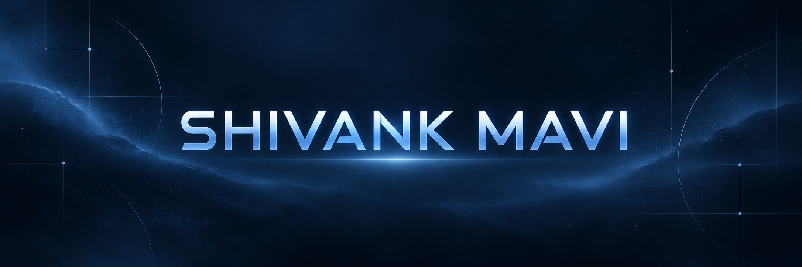

  

<h1 align="center">Hey, I'm Shivank Mavi.</h1>

  <strong>Software engineer building thoughtful SaaS products, full-stack applications, and AI-powered tools.</strong>

  <a href="https://instagram.com/mavi_shivank">Instagram</a>
  &nbsp;·&nbsp;
  <a href="mailto:mavishivank2348@gmail.com">Email</a>
  &nbsp;·&nbsp;
  <a href="https://github.com/shivan2310">GitHub</a>

---

## About me

I enjoy turning ideas into practical products—owning the path from a useful interface to reliable logic and the details that make everything work together.

Right now, I’m growing through **Java**, **DSA**, **AI/ML**, **cloud technologies**, **React**, and **Flutter**. I learn best by building, breaking things, and making the next version better.

**Open to learning opportunities, collaborations, and interesting problems to solve.**

## Selected work

| Project | What it does | Built with |
| --- | --- | --- |
| [**AutoPilot AI**](https://github.com/shivan2310/ai-workflow) | Turns everyday requests into structured workflows, then safely runs verified tools for budgets, task lists, and email drafts. Includes a live dashboard and persistent execution history. | React · TypeScript · FastAPI · Ollama · SQLite |
| [**ImportSafe**](https://github.com/shivan2310/import_safe) | Helps Indian buyers assess import risks before ordering. Reviews product details, surfaces certification and compliance questions, estimates landed costs, and explains next steps with evidence. | React · TypeScript · FastAPI · Python |
| [**Nivio**](https://github.com/shivan2310/Saas_start) | A private personal organizer for tasks, expenses, important dates, and a journal encrypted in the browser before it reaches the database. | Next.js · TypeScript · Supabase · Web Crypto |
| [**QuantumLab**](https://github.com/shivan2310/SIH2026) | An interactive quantum learning lab with a visual circuit builder, in-browser simulator, and live state visualizations to make quantum concepts easier to explore. | React · TypeScript · TanStack · Tailwind |

## What I build with

| Area | Tools |
| --- | --- |
| **Languages** | Java · JavaScript · Python · C · C++ · Dart |
| **Web & mobile** | HTML5 · React · Flutter |
| **Data & AI** | NumPy · Pandas · Matplotlib · scikit-learn · TensorFlow · PyTorch · Keras |
| **Exploring** | Cloud technologies · modern product engineering |

## A little GitHub activity

  
  

  

## Contribution snake

  

---

  <strong>Have something worth building?</strong> 
  <a href="mailto:mavishivank2348@gmail.com">Let’s talk</a> · <a href="https://github.com/shivan2310?tab=repositories">See my work</a>

